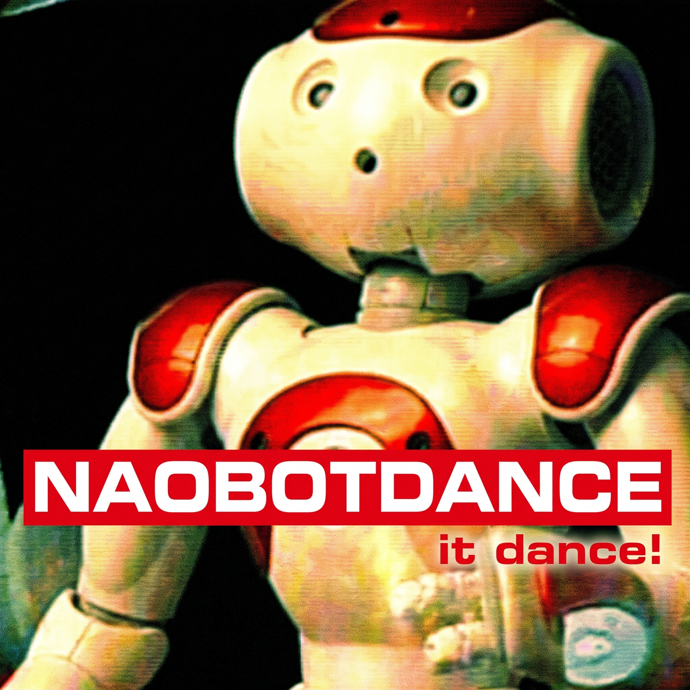

<p align="center">
  
</p>

# NAO Planning Challenge: Music-Synchronized Choreography

**Fundamentals of Artificial Intelligence**, Università di Bologna

## Team Information
- **Student Name(s):** [FILL TEAM MEMBER NAME(S)]
- **Student Email(s):** [FILL INSTITUTIONAL EMAIL(S)]

---

## Overview

This project is an automated, music-synchronized dance choreography planner and runner for the **SoftBank Robotics NAO** humanoid robot. It was built for the *Fundamentals of Artificial Intelligence* NAO Planning Challenge and tested in **Choregraphe Suite 2.8** (and works on a physical NAO).

**Music track:** Rick Astley, *Never Gonna Give You Up* (`rick_120s.mp3` / `rick_120s.wav`, 113.3 BPM, 120.0s)

Instead of hardcoding a fixed dance list, the system works in three stages:

1. **Audio Analysis (`audio_analyzer.py`)**  
   Reads the song to measure how loud each musical bar is, locate sudden pauses, and group the track into verses, choruses, and the outro.

2. **Choreography Planning (`nao_planner.py`)**  
   Inspects 37 available dance and posture scripts in `RobotPositions/` and uses **A\* search** to build a 29-step, ~111s routine (`choreography_plan.json`). The plan:
   - Starts in `StandInit` (`14-StandInit.py`) and finishes in `Crouch` (`6-Crouch.py`).
   - Includes all **6 mandatory positions** (`WipeForehead`, `Hello`, `15-StandZero`, `16-Sit`, `17-SitRelax`, `11-Stand`).
   - Includes **5 official intermediate moves** (`3-Double_movement`, `sprinkler`, `4-Arms_opening`, `8-Move_backward`, `7-Move_forward`).
   - Steps away from and back to the center of the stage, matching energetic moves to the chorus and calmer ones to the verses.

3. **Execution (`execute_choreography.py`)**  
   Plays the audio track and runs `choreography_plan.json` on a virtual or physical NAO. It keeps the robot on beat even when the simulator runs slow, stabilizes sitting and standing transitions so the robot does not tip over, and finishes within the 2-minute limit (verified at 115.4s in Choregraphe 2.8).

For the full technical report and Q&A, see [`pdf/documentation.pdf`](pdf/documentation.pdf).

---

## Requirements

- **Planner (`nao_planner.py`, `audio_analyzer.py`):** Python 2.7 or Python 3.x (standard library only, no external packages required).
- **Runner (`execute_choreography.py`):** Python 2.7 with the SoftBank Robotics **NAOqi Python SDK** (`naoqi`, included with Choregraphe Suite 2.8).

---

## Choregraphe Configuration

Before running the choreography on a virtual robot:

1. Open **Choregraphe Suite 2.8**.
2. Go to **Edit -> Preferences -> General** and set **Motor speed (%)** to `100`.
3. Under the **Virtual Robot** tab, select **NAO H25** as the robot model and click **OK**.
4. Connect to the virtual robot (default port `9559`).

---

## How to Run

1. **Start Choregraphe Suite 2.8** with a virtual NAO connected (default port `9559`), or connect to a physical NAO via its IP address.

2. **Run the choreography:**
   - **Windows** (using the included Choregraphe Python 2.7 wrapper):
     ```bat
     .\run_sim.bat execute_choreography.py 9559 --music rick_120s.mp3
     .\run_sim.bat execute_choreography.py <IP> <PORT> --music rick_120s.mp3
     ```
   - **Linux / macOS** (with `pynaoqi` on `PYTHONPATH`):
     ```bash
     PYTHONPATH=/path/to/pynaoqi/lib python execute_choreography.py 127.0.0.1 9559 --music rick_120s.mp3
     ```

3. **Dry-run test** (verifies the plan without connecting to a robot):
   - Windows: `.\run_sim.bat execute_choreography.py dry_run`
   - Linux / macOS: `python execute_choreography.py dry_run`

4. **Regenerate the plan** (optional, since `choreography_plan.json` is already included):
   ```bash
   python nao_planner.py --music rick_120s.mp3
   ```

---

## Project Structure

- `nao_planner.py`: A\* choreography planner.
- `audio_analyzer.py`: Pure-Python music beat, energy, and structure analyzer.
- `execute_choreography.py`: Cross-platform robot runner with beat sync and stability handling.
- `choreography_plan.json`: Generated 29-step dance plan (111.0s nominal).
- `rick_120s.mp3` / `rick_120s.wav`: 120s audio track (*Never Gonna Give You Up*, 113.3 BPM).
- `run_sim.bat`: Windows helper script for Choregraphe Python 2.7.
- `RobotPositions/`: Mandatory, official intermediate, course, and custom dance scripts.
- `pdf/`: Full technical documentation (`documentation.tex` and `documentation.pdf`).
- `README.md`: Project overview and setup instructions.
